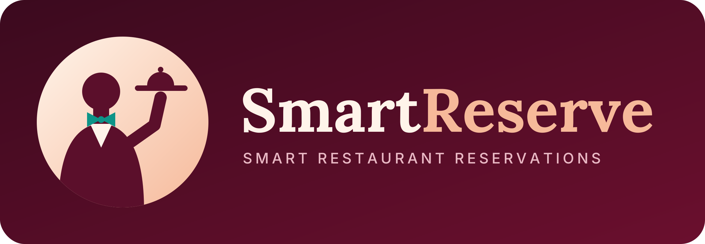
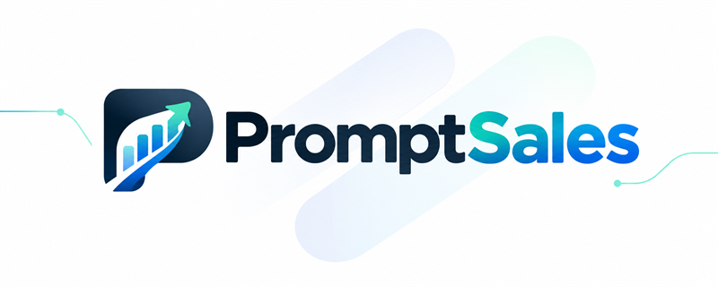

<h1 align="center">Christopher Daniel Vargas Villalta</h1>

  Computer Engineering student at the Instituto Tecnológico de Costa Rica (TEC) who builds full-stack and data-intensive software in teams.
  I focus on backend, data, and AI-powered products: designing databases, ETL pipelines, REST APIs, and Kubernetes deployments,
  and I also work on the frontend, like leading the frontend of a hackathon-winning platform.
  I enjoy leading projects, communicating technical decisions clearly, and turning user research into working products.

  <b>Computer Engineering @ <a href="https://www.tec.ac.cr/">TEC</a></b>

  

---

## Highlights

- **Winner of the CRTW Hackathon 2026** with PymeBoost, as frontend lead of a team of 4.
- **Participant in the [AUGE](https://diprovid.ucr.ac.cr/auge/) program** with PymeBoost.
- **Academic Excellence Scholarship** at TEC (I Semester 2026), awarded for outstanding academic performance.
- **Cambridge C1 Advanced** certified in English (overall score 190).

---

## Projects

<table>
  <tr>
    <td align="center" width="50%">
      
    </td>
    <td align="center" width="50%">
      <h3>PymeBoost</h3>
      🏆 <b>Winner of the CRTW Hackathon 2026</b> 
      Participant in the <a href="https://diprovid.ucr.ac.cr/auge/"><b>AUGE</b></a> program
    </td>
  </tr>
  <tr>
    <td valign="top" width="50%">
      Platform that matches Costa Rican SMEs with business advisors using AI.
      As <b>frontend lead</b> of a team of 4, I defined the frontend architecture and standards, organized the app into six feature modules
      (auth, matching, messaging, contracts, dashboard, reports), co-led user research and Maze usability tests,
      and set up CI/CD with GitHub Actions and automatic Vercel deploys.
    </td>
    <td align="center" valign="middle" width="50%">
      
      
      
      
        
      
      
    </td>
  </tr>
</table>

<table>
  <tr>
    <td align="center" width="50%">
      
    </td>
    <td align="center" width="50%">
      <h3>SmartReserve</h3>
      Distributed restaurant backend and analytics
    </td>
  </tr>
  <tr>
    <td valign="top" width="50%">
      I built most of the FastAPI REST API with AWS Cognito JWT auth and RBAC,
      using the DAO pattern to switch between PostgreSQL and sharded MongoDB with a single config variable.
      Microservices run on Kubernetes behind an Nginx load balancer with Redis caching, Elasticsearch search, and a 149-test CI pipeline,
      plus a daily Airflow pipeline that loads a Hive star-schema data warehouse with Spark analyses and a Neo4j graph for delivery routes.
    </td>
    <td align="center" valign="middle" width="50%">
      
      
      
      
      
      
      
      
        
      
    </td>
  </tr>
</table>

<table>
  <tr>
    <td align="center" width="50%">
      
    </td>
    <td align="center" width="50%">
      <h3>Merkadit</h3>
      Gastronomic market management
    </td>
  </tr>
  <tr>
    <td valign="top" width="50%">
      Management system for gastronomic markets and the businesses inside them. I designed most of the 56-table MySQL database
      (users, contracts, sales, and finance modules), with stored procedures for point-of-sale registration and monthly business settlements,
      a FastAPI REST API with a 4-layer architecture (handler, controller, service, repository), and a Power BI dashboard.
    </td>
    <td align="center" valign="middle" width="50%">
      
      
      
      
      
        
      
    </td>
  </tr>
</table>

<table>
  <tr>
    <td align="center" width="50%">
      
    </td>
    <td align="center" width="50%">
      <h3>PromptSales</h3>
      Multi-database data platform
    </td>
  </tr>
  <tr>
    <td valign="top" width="50%">
      Multi-database platform for an AI marketing and sales company, built by a team of 5. I designed the central PostgreSQL data warehouse
      (54 tables, six design iterations) and built an incremental ETL pipeline with SSIS and MongoDB aggregations that merges two SQL Server
      databases and one MongoDB database, loading only new records with a delta watermark per source and running every 11 minutes.
      I also set up the team's Kubernetes environment with five database instances, secrets, and PowerShell deploy scripts.
    </td>
    <td align="center" valign="middle" width="50%">
      
      
      
      
      
      
        
      
    </td>
  </tr>
</table>

---

## Other Projects

- **[DUA Streamliner](https://github.com/chris124v/DUA_StreamLiner)**: system design for automating Costa Rica's customs declaration (DUA) with OCR and AI field extraction, with a FastAPI backend using Domain-Driven Design and a React frontend on Google Cloud.
- **[Arkanoid ED](https://github.com/chris124v/Arkanoid-ED)**: remake of the classic Arkanoid in C++ with Allegro 5, with 10 levels, enemies, and blocks managed with linked lists and dynamic memory.
- **[Huffman Compressor](https://github.com/chris124v/Huffman-Compressor)**: C++ console tool that compresses and decompresses any file with the Huffman algorithm and shows compression statistics.
- **[UndercoverParties](https://github.com/chris124v/UndercoverParties)**: Django monolith with server-side rendering to publish parties, accept guests, and find them on a Leaflet map.
- **[Speedboats](https://github.com/chris124v/Speedboats)**: Micronaut microservices with a React and Tailwind frontend to manage community boat tours.
- **[ChatBotProlog](https://github.com/chris124v/ChatBotProlog)**: console chatbot in Prolog that answers questions, handles synonyms, and learns new knowledge through logical inference.

---

## Technology Stack

<table>
  <tr>
    <td><b>Languages</b></td>
    <td>
      
      
      
      
      
      
    </td>
  </tr>
  <tr>
    <td><b>Frontend</b></td>
    <td>
      
      
      
      
      
    </td>
  </tr>
  <tr>
    <td><b>Backend</b></td>
    <td>
      
      
      
      
    </td>
  </tr>
  <tr>
    <td><b>Databases</b></td>
    <td>
      
      
      
      
      
      
    </td>
  </tr>
  <tr>
    <td><b>Data Engineering</b></td>
    <td>
      
      
      
      
      
      
    </td>
  </tr>
  <tr>
    <td><b>Cloud & DevOps</b></td>
    <td>
      
      
      
      
      
      
      
    </td>
  </tr>
  <tr>
    <td><b>Testing</b></td>
    <td>
      
      
      
    </td>
  </tr>
</table>

---

## What I Enjoy as a Developer

- **Leading projects:** taking the lead role, setting the technical direction, and setting goals.
- **Working as a team:** building things together and sharing what each person does best.
- **Being creative:** finding new ways to solve problems and turning ideas into working products.
- **Meeting people:** connecting with developers, users, and people from other fields.
- **Listening to ideas:** hearing other points of view and letting them change my perspective.

---

## Connect with Me

- **Email:** [cdvv12@gmail.com](mailto:cdvv12@gmail.com)
- **LinkedIn:** [linkedin.com/in/christopher-daniel-vargas-villalta-433529317](https://www.linkedin.com/in/christopher-daniel-vargas-villalta-433529317/)
- **GitHub:** [github.com/chris124v](https://github.com/chris124v)
